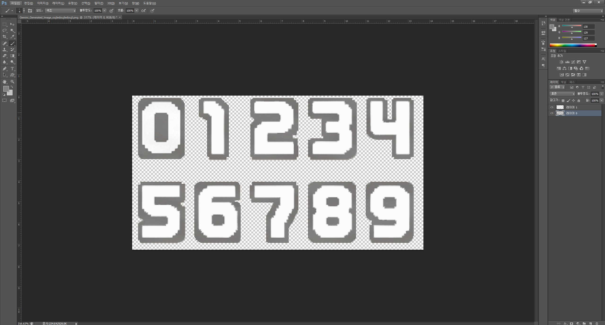
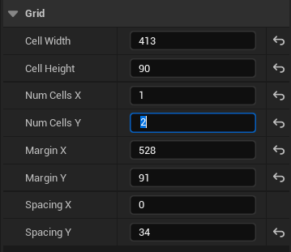
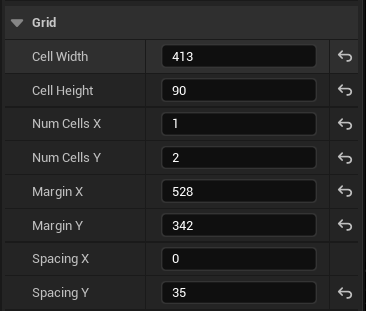

# 05-16~05-18 개발일지 및 작업기록

> Source: https://www.notion.so/361070f7557480d79f14ceda59bbab6c
>
> Synced from Notion. Do not edit this generated file directly.

## Phase 7. 레벨 프로그레션(Progression) 및 게임 플로우 완성

### 1. 레벨 종료 배리어(Barrier) 및 클리어 로직 구현

- **배리어 블록 생성:** 100m(또는 특정 깊이)마다 맵 전체 가로를 가로지르는 특수 블록 라인 생성.

- **화면 클리어 기능:** 배리어가 파괴되는 순간 현재 화면의 `GridMap`에 있는 일반 블록을 `Pop()` 처리하거나 풀(Pool)로 회수하는 함수를 작성했습니다.

### 2. 레벨 단위 맵 재구성 (Recycle by Level)

- **`ResetAndSpawnNextLevel`**** 함수 구현:** 기존 `RecycleTopLine` 대신 화면 전체를 비우고, 플레이어 발밑부터 새로운 100m 구간의 맵을 다시 생성하는 로직을 구현했습니다.

**1. 심연 스폰 (Just-In-Time Spawning) 로직**

  - **개념:** 맵을 전환할 때 캐릭터를 억지로 위로 순간이동(Teleport)시키는 대신, 매니저의 기준점(`CurrentStartRow`)을 갱신하여 현재 캐릭터의 발밑 더 깊은 Z축(심연)에 다음 레벨의 블록들을 쫙 깔아줍니다.

  - **효과:** 캐릭터의 좌우(X축) 위치가 그대로 유지되며 자연스럽게 자유낙하를 하게 되어, 미스터 드릴러 특유의 "다음 층으로 떨어지는 쾌감"을 완벽하게 살렸습니다.

**2. 무결성 대청소 (Clear & Reset) 로직**

  - **개념:** 배리어가 파괴되는 순간 장부(`GridMap`)의 모든 블록을 회수합니다. 이때 발생할 수 있는 이중 풀링(Double Pooling)을 막기 위해 바구니에 이미 블록이 있는지 검사합니다.

  - **효과:** 또한 `ResetBlockState()`를 통해 애니메이션, FSM 상태, 유령 좌표를 바구니에 넣기 전/후로 완전히 초기화(Format)하여 재활용 시 발생하는 좀비 버그를 원천 차단했습니다.

**3. 동적 바닥 경계 (Dynamic Bounds) 로직**

  - **개념:** 블록이 아래로 떨어질 수 있는지 계산하는 `ProcessFalling` 함수가 고정된 숫자(`MaxRows`) 대신, 현재 레벨의 진짜 바닥(`CurrentStartRow + LevelHeight`)을 동적으로 계산하도록 수정했습니다.

  - **효과:** 레벨과 맵 깊이에 관계없이 블록 하강 시스템이 동일한 방식으로 동작하도록 구성했습니다.

### 3. 카메라 시스템 및 추적 로직

- **카메라 수직 추적:** 플레이어가 내려갈 때 카메라가 부드럽게 따라 내려가는 기능 (SpringArm 또는 직접 위치 계산).

- **레벨 업 연출:** 화면 내 블록이 모두 터질 때 발생하는 이펙트 및 카메라 흔들림 추가.

### 4. UI 및 게임 데이터 연동 (서브시스템 활용)

- **HUD 제작:** `GameStatusSubsystem`에 저장된 산소(Oxygen) 잔량과 현재 깊이(Depth)를 화면에 표시.

- **산소 경고 UI:** 산소가 20% 미만일 때 화면이 깜빡이거나 경고음이 출력되는 연출.

- 폰트 이미지 편집 작업

[https://jeremyoduber.itch.io/fonts-for-gb-studio/download/eyJpZCI6NTQ1NjUxLCJleHBpcmVzIjoxNzc5MDAyNjUyfQ%3d%3d%2e6QWy8NZ%2b7iHrYQ1PZIhFIbDbFD8%3d](https://jeremyoduber.itch.io/fonts-for-gb-studio/download/eyJpZCI6NTQ1NjUxLCJleHBpcmVzIjoxNzc5MDAyNjUyfQ%3d%3d%2e6QWy8NZ%2b7iHrYQ1PZIhFIbDbFD8%3d)

[https://yogi-tronimal.itch.io/gbfx](https://yogi-tronimal.itch.io/gbfx)

[https://yogi-tronimal.itch.io/gbfx2/download/eyJpZCI6MjUxMDE4NCwiZXhwaXJlcyI6MTc3OTAwMzI0N30%3d%2eXfdpq1b4FrlSQNYdrvG4rKnUvwU%3d](https://yogi-tronimal.itch.io/gbfx2/download/eyJpZCI6MjUxMDE4NCwiZXhwaXJlcyI6MTc3OTAwMzI0N30%3d%2eXfdpq1b4FrlSQNYdrvG4rKnUvwU%3d)

[https://kenney.nl/assets/ui-pack](https://kenney.nl/assets/ui-pack)

# [개발 일지] Phase 7: 인게임 HUD 및 하이브리드 UI 구축 완료

- **작업 일자:** 2026년 5월 17일

- **작업자:** Yang Ji-seop

- **진행 상태:** 완료 (개발 브랜치 커밋 및 빌드 성공)

---

## 🚀 1. 주요 작업 요약

인게임 UI의 퍼포먼스 최적화와 유지보수 편의성을 극대화하기 위해, 유니티식 매 프레임 UI 갱신 방식을 탈피하고 언리얼 엔진 5 표준인 **C++ Base + Blueprint Layout (하이브리드)** 구조를 설계 및 구현했습니다.

## 🛠️ 2. 상세 구현 내용

### 📐 UI 레이아웃 및 최적화 기법 (UMG)

- **컨테이너 기반 정렬:** `Horizontal Box`와 `Border`/`Overlay` 패널을 적절히 조합하여, 해상도가 바뀌어도 UI가 깨지지 않는 유연한 구조를 확보했습니다.

- **비트맵 폰트 최적화:** 실시간으로 변하는 인게임 수치(DEPTH, SCORE, LEVEL)에 무거운 폰트 파일 대신 가벼운 '숫자 스프라이트(0~9 조각 이미지)'를 매칭하여 메모리와 연산 속도를 대폭 최적화했습니다.

- **대량 에셋 다중 편집:** 언리얼의 `Edit Selection in Property Matrix` 기능을 활용하여 들쭉날쭉하던 숫자 스프라이트 10장의 피벗과 크기 규격을 단 몇 초 만에 일괄 통일(Bottom Center 정렬)했습니다.

### 🧠 하이브리드 C++ 클래스 설계 (`UInGameHUDWidget`)

- **`meta = (BindWidget)`**** 활용:** 블루프린트 레이아웃의 위젯 이름(`OxygenImage`, `HB_Depth` 등)과 C++ 변수 이름을 완벽히 매칭시켜, 포인터를 수동으로 캐싱할 필요 없이 자동으로 연동되도록 바인딩했습니다.

- **고속 고정밀 자릿수 쪼개기 알고리즘 (나머지 연산):** 문자열 변환 없이 몫(`/)`과 나머지(`%`) 연산을 활용한 **역순 루프(Reverse For Loop)** 기법으로 깊이 데이터를 각 자릿수 이미지로 즉시 변환하는 최적화 로직을 이식했습니다.

- **동적 머티리얼(MID) 제어:** 명시적 C++ 참조(`OxygenBaseMaterial`)를 통해 방사형(Radial) 산소 감소 효과 셰이더의 파라미터(`oxygenPercent`)를 매 프레임 안전하고 부드럽게 제어하도록 바꿨습니다. 이로 인해 UI 블루프린트의 무거운 `Event Tick` 노드를 100% 청소하는 데 성공했습니다.

---

# 📝 [개발 일지] Phase 8: 오디오 & 시각적 폴리싱 (Juiciness) 완료

- **작업 일자:** 2026년 5월 19일

- **작업자:** Yang Ji-seop

- **진행 상태:** 완료 (개발 브랜치 커밋 및 빌드 성공)

---

## 🚀 1. 주요 작업 요약

게임의 뼈대(Core Loop) 완성을 넘어, 유저에게 '타격감'과 '쾌감(Juice)'을 전달하기 위한 오디오 및 시각적 피드백 시스템을 구축했습니다. 다중 블록 파괴 시 발생하는 오디오 클리핑을 방지하기 위해 서브시스템 기반의 사운드 매니저를 도입하였고, 카메라 셰이크를 통해 아케이드 게임 특유의 묵직한 손맛을 구현했습니다.

## 🛠️ 2. 상세 구현 내용

### 🎵 사운드 매니저 시스템 구축 (`GameStatusSubsystem`)

- **BGM 제어 (Fade In/Out):** `UAudioComponent`를 활용하여 씬 전환이나 게임 오버 시 배경음악이 부드럽게 교체되도록 구조화했습니다.

- **SFX 피치 동적 스케일링 (Pitch Modulation):** 블록 연쇄 파괴(Match) 시, 터진 블록 개수(`ComboCount`)를 매니저가 전달받아 **사운드의 음높이(Pitch)를 최대 2배까지 점진적으로 상승**시키는 도파민 유발 로직을 구현했습니다.

- **오디오 클리핑(Audio Clipping) 방지:** 블록 객체 개인이 소리를 내지 않고, 파괴 로직(`CheckMatch`, `OnInteracted`)이 끝나는 시점에 서브시스템이 단 1회의 사운드만 재생하도록 아키텍처를 최적화했습니다.

### 💥 시각적 타격감 및 예외 처리 연출 (`ABlock`)

- **카메라 흔들림 (Camera Shake):** `LegacyCameraShake` 기반의 `CS_BlockPop` 에셋을 제작(지속시간 0.15초, 진폭 8.0의 짧고 강한 진동)하여 블록 파괴 시(`ClientPlayCameraShake`) 화면이 타격감 있게 흔들리도록 연동했습니다.

- **'팅!' 튕김 사운드 및 무적 판정:** 흔들리거나(Anticipating) 추락 중(Falling)인 블록을 플레이어가 타격할 경우, 연쇄 파괴 로직 에러를 막기 위해 파괴를 무시(`return;`)하고 대신 방어/튕김 사운드(`BlockHitSound`)를 재생하여 쫄깃한 퍼즐 액션 요소를 추가했습니다.
