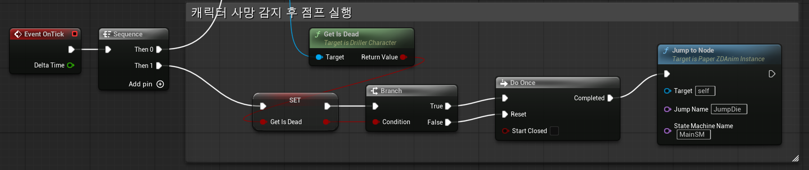
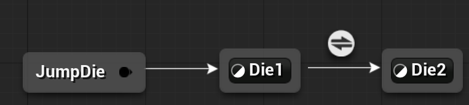

# 2026-05-13 개발일지 및 작업기록

> Source: https://www.notion.so/35f070f755748088afe5f77cd6663273
>
> Synced from Notion. Do not edit this generated file directly.

**Phase 4. 중력 및 블록 낙하 시스템 (Gravity & Block Falling)**

**1. 블록 하단 감지 및 등속 낙하 시스템 구현**

- 레이캐스트를 사용해 하단 블록을 감지하고 낙하 여부를 판단하는 시스템을 구현했습니다.

- `Tick` 내부에서 `FMath::VInterpConstantTo`를 활용해 부드러운 낙하 이동을 적용했습니다.

- 블록 파괴 시(`OnInteracted`) 바로 위 블록을 레이캐스트로 감지하고, 연쇄 낙하 신호(`CheckAndFall`)를 전달하는 로직을 추가했습니다.

- `ABlock`에 `EBlockState`(`Idle`, `Anticipating`, `Falling`) 기반 상태 머신을 도입했습니다.

**2. 부드러운 낙하 이동 (Lerp / Interp)**

- 등속 보간(MoveTowards)으로 다음 프레임 위치 계산 (이동 속도는 임의로 300.f 설정)
`FVector nextLocation = FMath::VInterpConstantTo(currentLocation, targetLocation, DeltaTime, 300.f);`

**3. 연쇄 낙하 트리거 (Chain Reaction)**

- 블록이 파괴되면 상태를 전환하고, 위쪽 방향 레이캐스트를 통해 연쇄 낙하 트리거를 발생시키도록 구현했습니다.

- 초기 구현에서는 이후 매치 4 기능과의 연동을 고려해 레이캐스트 기반 탐색 방식을 사용했습니다.

**4. 플레이어 압사 판정 (Player Crush)**

- 블록이 낙하 전 **대기(Anticipating) 상태일 때** 플레이어가 미리 밑으로 들어가면 `NotifyActorBeginOverlap`이 1회만 호출되어 압사 판정이 무시되는 끼임 버그가 발생함.

  - 이를 해결하기 위해 낙하가 실제로 시작되는 `StartFalling()` 첫 프레임에 `IsOverlappingActor` 또는 `GetOverlappingActors`를 통해 겹친 플레이어를 한 번 더 검사하도록 수정했습니다.

1. 아키텍처 개선: 전역 상태 관리자(Subsystem) 도입

- 플레이어 사망 시 캐릭터가 직접 게임 오버를 처리하지 않고, `UGameStatusSubsystem`(`UWorldSubsystem` 상속)을 통해 사망 이벤트(Delegate)를 방송하도록 구현했습니다.

- 객체 간 결합도를 낮추고 데이터 주도(Data-Driven) 설계를 적용했습니다.

[Video](../assets/video-4849f1e1.mp4)

- 파란 선은 블록 파괴 시 생성되는 레이캐스트를 나타냅니다.

- 애니메이션은 Tick에서 시퀀스로 전환되며, 사망 애니메이션 점프 동작을 확인했습니다.

- `Die 1`(압사) → `Die 2`(승천) 순서로 사망 애니메이션을 재생합니다.
