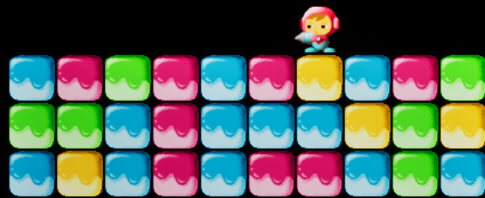

# 2026-05-14 개발일지 및 작업기록

> Source: https://www.notion.so/35f070f755748095bdddce6be7fdb061
>
> Synced from Notion. Do not edit this generated file directly.

## Phase 5. 매치 4 퍼즐 시스템 체크리스트

<!-- Unsupported Notion block: heading_4 -->

현재 `ABlock.h`에는 블록의 색상이나 타입을 구분할 수 있는 변수가 없었습니다.
퍼즐 매칭을 구현하려면 블록의 색상 정보를 비교할 수 있는 기준 데이터가 필요합니다.

- 블록 파괴 애니메이션은 기존에 파란색만 준비되어 있어, 다른 색상에 대한 파괴 애니메이션도 추가 작업이 필요합니다.

<!-- Unsupported Notion block: heading_4 -->

블록의 낙하가 완전히 끝나고 정착하는 시점이 매칭 검사의 시작점입니다.
작성해 두신 `ABlock::Tick` 함수 내부의 도착 판정(`FVector::Dist < 1.0f`) 로직 안에서, 상태가 `Idle`로 변하는 순간 매치 검사 함수를 호출하는 것이 구조상 가장 깔끔합니다.

<!-- Unsupported Notion block: heading_4 -->

재귀 또는 Queue를 활용해 상하좌우를 탐색할 때는 무한 루프를 방지하기 위해 이미 확인한 블록을 기록해야 합니다.

- **Unity 브릿지:** 유니티 C#에서 `HashSet<Block>`을 써서 중복 검사 속도를 O(1)로 만들었던 것과 정확히 같은 원리입니다. 언리얼에서는 `TSet<ABlock*>`을 사용해 `Contains()`로 방문 여부를 체크하세요. `TArray`를 쓰면 찾을 때마다 선형 탐색(O(N))을 하므로 낭비입니다.

- 재귀 함수 `ExecuteFloodFill`의 매개변수

- `void ExecuteFloodFill(EBlockColor TargetColor, ABlock* CurrentBlock, TSet<ABlock*>& OutMatchedBlocks);`

  - **기준이 되는 색상** (비교용)

  - **현재 탐색을 진행 중인 블록 자신** (포인터)

  - TSet<ABlock*>& (탐색한 블록들을 차곡차곡 담아두고 중복을 검사할 컨테이너)

- 재귀 함수 구현부

  - **공간이 비어있을 때 (블록이 아닐 때):** `CurrentBlock == nullptr`

  - **찾는 색상이 아닐 때:** `CurrentBlock->blockColor != TargetColor`

  - **이미 확인한(TSet에 들어있는) 블록일 때 (핵심!):** `OutMatchedBlocks.Contains(CurrentBlock)`

<!-- Unsupported Notion block: heading_4 -->

매칭된 블록이 4개 이상(`TSet.Num() >= 4`)이라면 반복문을 돌며 일괄 파괴합니다.
이때 이미 만들어두신 `OnInteracted()`를 재활용하면, 파괴되면서 자동으로 자기 위쪽 블록들의 `CheckAndFall()`을 호출해 연쇄 낙하가 자연스럽게 발생할 것입니다.

---

### 리마인드

- [교통체증 버그 및 블랙홀 버그](https://app.notion.com/p/35d070f75574801e80cffdd55aecc046#360070f7557480a8a520c83f89100ce8) 

### 1. 그리드 기반 FloodFill 이해하기 (개념 리뷰)

기존 방식과 리팩토링된 방식의 결정적인 차이는 '주변 친구를 어떻게 찾는가'입니다.

- **기존 (레이캐스트):** 블록이 직접 사방으로 레이저를 쏴서 부딪히는 액터가 누구인지 물어봅니다. (물리 연산 필요, 프레임 오차에 취약)

- **현재 (그리드 장부):** 블록은 가만히 있고, **사장님(MapManager)의 장부**를 펼쳐서 내 좌표 `(X, Y)`의 상하좌우 좌표에 누가 적혀 있는지 확인합니다.

- 데이터 좌표를 먼저 갱신하고 실제 오브젝트가 그 결과를 따라 이동하므로, 물리 오차로 인한 연산 오류를 줄일 수 있습니다.

---

### 2. 게임 로직 흐름도 (흐름 중심)

데이터(논리)와 연출(시각)이 분리되어 동작하면서도 하나의 게임 흐름으로 연결되는 구조를 보여주는 흐름도입니다.

<!-- Unsupported Notion block: column_list -->
