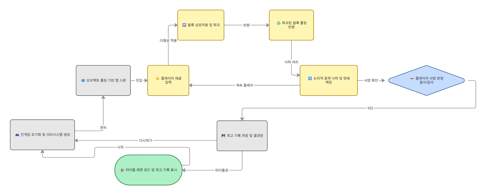
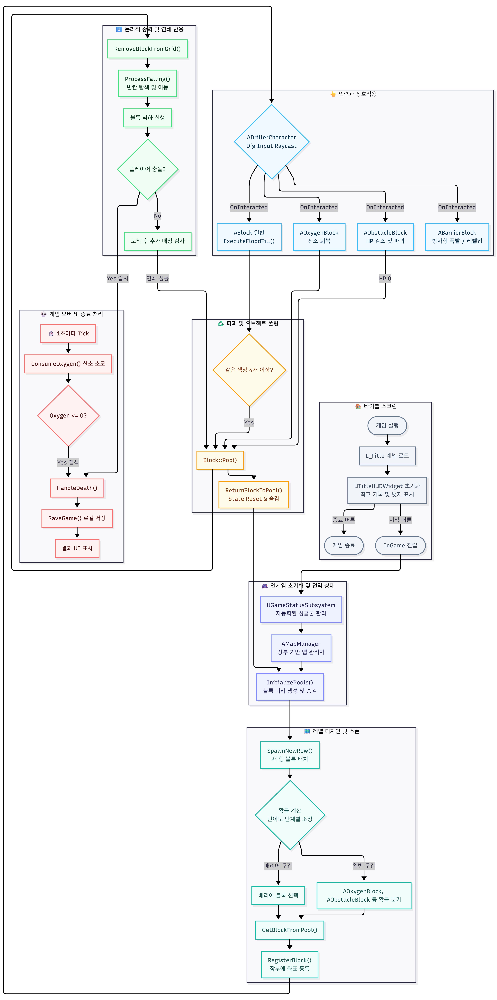

# Mini Driller Project Documentation Index

> Source: https://www.notion.so/367070f755748170bc22d7a39a8820e6
>
> Synced from Notion. Do not edit this generated file directly.

## 📂 1. 프로젝트 관리 (Project Management)

_프로젝트의 전체적인 방향성과 현재 진행 상태를 확인할 수 있습니다._

- [미니 드릴러 (Mini Driller) - v2.4](https://www.notion.so/359070f7557480b09b55fe9547616df1)

- [✅ 체크리스트 (Checklist)](https://www.notion.so/35e070f7557481a0a825ce8b76fa77b2)

- [📝 할 일 백로그 (Backlog)](https://www.notion.so/35e070f75574817cb6c3c02fc653b199)

## 🛠️ 2. 기술 사양 및 트러블슈팅 (Technical Specs)

_핵심 알고리즘, 외부 플러그인 활용법 및 문제 해결 기록입니다._

- [트러블슈팅](https://www.notion.so/35d070f75574801e80cffdd55aecc046)

- [PaperZD사용방법](https://www.notion.so/35e070f7557480788f11e71fa49c1f04)

## 📅 3. 개발 일지 (Development Logs)

_일자별 진행 상황과 코드 변경 이력입니다._

- 📅 개발 일지 및 작업 기록

## 🖼️ 4. 시각 자료 (Assets & Diagrams)

_게임 흐름 및 시스템 구조를 시각화한 자료입니다._

### 게임 흐름도

### 게임 로직 다이어그램

- [🎮 Mini Driller 프로젝트 발표 자료 (Draft)](https://www.notion.so/367070f7557480d69c70cc6c0ddb96b8)

- [MiniDriller 서버 연동](https://www.notion.so/370070f75574805b9e11db90bff97a43)
