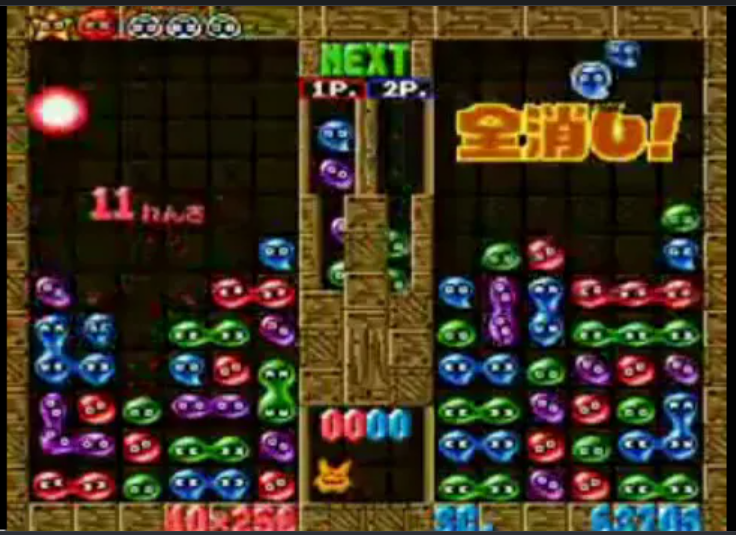

# 미니 드릴러 (Mini Driller) - v2.4

> Source: https://www.notion.so/359070f7557480b09b55fe9547616df1
>
> Synced from Notion. Do not edit this generated file directly.

## 1. 프로젝트 개요 (Overview)

- **장르**: 2D 타임어택 무한 채굴 아케이드

- **개발 엔진**: Unreal Engine 5.6.1

- **핵심 목표**: 2주 안에 핵심 게임 루프를 완성하고, C++ 기반 게임 시스템 구현 역량을 검증하는 것입니다.

- **주요 구현 역량**: 오브젝트 풀링(Object Pooling), 다형성, 서브시스템, 그리드 기반 중력 처리, 2D 애니메이션 상태 제어

- **Core Loop**: 블록 파괴, 캐릭터 및 블록 하강, 산소/난이도 관리, 깊이에 따른 블록 재배치를 반복하는 구조입니다.

## 2. 참고 자료 (References)

- **게임 플레이 레퍼런스**

  - [미니 미스터 Driller  - 온라인에서 무료로 플레이하기 | Game-Game (게임-게임)](https://kr.game-game.com/192620/)

  - [Pico Driller](https://canarigames.itch.io/picodriller)

  - [레트로열전 GBA 미스터드릴러A 초반3배속 플레이 #shorts](https://youtube.com/shorts/34uwbWnwLio?si=1xp-6Mj6w1mJ3CLN)

  - [미스터 드릴러 나무위키](https://namu.wiki/w/%EB%AF%B8%EC%8A%A4%ED%84%B0%20%EB%93%9C%EB%A6%B4%EB%9F%AC%20%EC%8B%9C%EB%A6%AC%EC%A6%88)

## 3. 에셋 및 플러그인 (Assets & Plugins)

- **플러그인**

  - `Paper2D`: 2D 스프라이트 및 타일맵 렌더링에 사용했습니다.

  - `PaperZD`: 2D 애니메이션 상태 머신(FSM)과 노티파이 기반 이벤트 제어에 사용했습니다.

- **에셋 수급처**

  - [Home · Kenney](https://kenney.nl/) (UI, 기본 블록 타일)

  - [itch.io](http://itch.io/) (2D Pixel 팩 - 캐릭터 애니메이션)

  - [The Spriters Resource](https://www.spriters-resource.com/) (미스터 드릴러 스프라이트)

  - [101soundboards](https://www.101soundboards.com/) (사운드 관련)

  - gemini 이미지 및 음악 생성

## 4. 핵심 클래스 설계 (Class Architecture)

### ① `UGameStatusSubsystem` (전역 상태 및 데이터 매니저)

- **역할**: `UWorldSubsystem`으로 월드 생명주기에 따라 관리되며, 게임 오버 전까지 유지되어야 하는 데이터와 난이도를 중앙에서 관리합니다.

- **주요 변수**

  - `float CurrentOxygen`: 현재 산소량입니다. 기본값 100에서 시작하며 시간에 따라 감소합니다.

  - `currentScore`: 블록 파괴와 콤보에 따라 계산되는 현재 점수입니다.

  - `int32 CurrentDepth`: 현재 도달한 깊이입니다.

  - `int32 CurrentLevel`: 현재 레벨입니다. 깊이 100m마다 증가합니다.

  - `int32 TotalScore`: 누적 점수입니다.

  - `bool bIsPlayerDead`: 플레이어 사망 상태를 기록합니다.

- **주요 이벤트(델리게이트):**

  - `FOnPlayerDiedDelegate OnPlayerDied`: 플레이어 사망 시 UI와 시스템에 사망 이벤트를 전달하는 디커플링용 델리게이트입니다.

- **주요 함수**

  - `void AddScore(int32 Amount)`: 점수를 추가합니다.

  - `void ConsumeOxygen(float Amount)`: 산소를 소모합니다. 레벨이 증가할수록 소모량이 커집니다.

  - `bool IsGameOver() const`: 산소가 0 이하이거나 플레이어가 압사한 경우 `true`를 반환합니다.

  - `void NotifyPlayerDeath()`: 캐릭터 사망 정보를 서브시스템에 전달합니다.

  - `void CheckLevelUp()`: 깊이 증가에 따라 레벨업 여부를 확인하고, 필요 시 맵 매니저에 레벨 전환 이벤트를 전달합니다.

- **핵심 로직**

  - 산소 소모 공식은 `1.0 + (Level - 1) * 0.2`입니다. 레벨이 오를수록 산소 소모 속도가 증가합니다.

  - `UMiniDrillerSaveGame`을 통해 최고 깊이와 최고 점수를 저장합니다.

### ② `AMapManager` (오브젝트 풀링 및 그리드 데이터 매니저)

- **역할**: 화면에 필요한 수의 블록만 메모리에 유지하고, `GridMap`을 통해 모든 블록의 논리 좌표를 중앙에서 관리합니다. 빈 공간이 발생하면 데이터 기준으로 중력 연산을 수행하고, 각 블록에 시각적 낙하를 지시합니다.

  - [그리드 데이터(GridMap)](https://app.notion.com/p/367070f755748076ad06f4be02086531#366070f755748014a5dbc579a71dcc47)

- **주요 변수:**

  - `TMap<FIntPoint, ABlock*> GridMap`: 블록의 논리 좌표와 실제 블록 인스턴스를 연결하는 그리드 데이터입니다.

    - `FIntPoint`는 Unreal Engine에서 정수형 2D 좌표를 표현하는 구조체입니다.

    - [https://dev.epicgames.com/documentation/unreal-engine/API/Runtime/Core/TIntPoint](https://dev.epicgames.com/documentation/unreal-engine/API/Runtime/Core/TIntPoint)

  - **풀링 시스템**: `Normal`, `Oxygen`, `Obstacle`, `Barrier` 타입별로 개별 풀을 관리합니다.

  - **레벨 전환**: `Barrier` 파괴 시 `ClearScreenBlocksRadially`로 화면 블록을 방사형으로 제거한 뒤 다음 구간을 스폰합니다.

  - `TArray<ABlock*> BlockPool`: 재사용 가능한 블록 인스턴스 배열입니다.

  - `float TileSize`: 타일 배치 기준 크기입니다.

- **주요 함수:**

  - `InitializeMap()`: 초기 블록 풀을 생성하고 그리드 데이터를 등록합니다.

  - `RegisterBlock() / RemoveBlockFromGrid()`: 블록 데이터를 그리드에 등록하거나 제거합니다.

  - `ProcessFalling(Col, StartRow)`: 특정 좌표에서 빈 공간이 발생했을 때 위쪽 블록의 목표 좌표를 계산하고, `PrepareToFall`을 통해 시각적 낙하를 예약합니다.

### ③ `ABlock` (부모 클래스 및 시각적 뷰)

- **역할**: 모든 채굴 대상과 상호작용 오브젝트의 부모 클래스입니다. 색상 정보, 매치 4 판정, 플러드 필(Flood Fill) 탐색의 기본 동작을 제공합니다.

- **주요 변수:**

  - `int32 GridX, GridY`: 블록의 현재 논리 좌표입니다.

  - `AMapManager* mapManagerRef`: 반복적인 `Cast` 연산을 줄이기 위해 스폰 시 주입받는 맵 매니저 참조입니다.

- **상태 정의:** `EBlockState` (Idle, Anticipating, Falling)

- **주요 함수:**

  - `PrepareToFall(TargetLocation)` / `ActuallyStartFalling()`: 맵 매니저의 중력 지시를 받아 대기 상태를 거친 뒤 목표 위치로 낙하합니다.

  - `ExecuteFloodFill(...)`: 물리적 레이캐스트 대신 `GridMap`을 조회하여 상하좌우의 동일 색상 블록을 재귀적으로 탐색합니다.

  - `Pop()`: 파괴 시 그리드에서 자신을 제거하고, 맵 매니저에 중력 연산을 요청한 뒤 파괴 이펙트 재생과 충돌 비활성화를 수행합니다.

  - `CheckMatch()`: 낙하 후 정착한 위치에서 4개 이상 연결된 동일 색상 블록을 확인하고 자동 파괴를 처리합니다.

- 자식 클래스: `OxygenBlock`, `ObstacleBlock`, `BarrierBlock`

  - `OxygenBlock`: 캐릭터와 상호작용할 때 산소를 회복시키는 블록입니다.

  - `ObstacleBlock`: 체력을 가진 장애물 블록입니다. 채굴할 때마다 체력이 1씩 감소하며, 파괴 시 산소 페널티가 적용됩니다.

  - `BarrierBlock`: 레벨 마지막 구간을 막는 블록입니다.

    - 파괴 시 점수를 지급하고, 방사형 제거 연출과 함께 다음 레벨로 진행합니다.

### ④ `ADrillerCharacter` (플레이어 캐릭터)

- **역할**: 플레이어 입력을 받아 이동과 채굴을 처리합니다.

  - PaperZD를 사용해 유한 상태 머신 기반 애니메이션을 갱신합니다.

- 2D 게임 구조에 맞춰 `APaperCharacter`를 상속합니다.

- **조작법**

  - `Spacebar`: 채굴 명령

  - 방향키 또는 `A`/`D`: 좌우 이동

- **애니메이션**

  - 속도 값에 따라 기본 상태를 `Idle` 또는 `Move`로 전환합니다.

  - 채굴 입력 시 입력 방향에 따라 좌우 또는 아래 방향 채굴 애니메이션을 재생합니다.

    - 디깅 애니메이션 종료 시 노티파이를 통해 `Idle` 또는 `Move` 상태로 전환합니다.

  - 블록 타일 기준 거리 이상 낙하하는 경우 하강 애니메이션을 재생합니다.

  - 캐릭터 사망 시 사망 원인을 판별하고, 원인에 맞는 사망 애니메이션을 재생합니다. 애니메이션 종료 후에는 노티파이를 통해 결과 화면으로 전환합니다.

- **주요 기능**

  - `void Dig()`: 채굴 명령을 처리합니다.

    - 플레이어 입력 방향을 기준으로 레이캐스트를 수행하고, 감지된 블록의 상호작용 함수를 호출합니다.

  - `FinalizeDeath()`: 사망 애니메이션 종료 시 호출됩니다.

    - 서브시스템에 플레이어 사망 이벤트를 전달합니다.

## 5. 핵심 메커니즘 (Core Mechanics)

- **채굴 및 상호작용**

  - 플레이어의 입력 방향에 따라 레이캐스트(Line Trace) 방향을 동적으로 결정합니다. 좌우 입력이 있으면 해당 방향을 채굴하고, 입력이 없으면 아래 방향을 채굴합니다.

- **블록 최적화**

  - 블록은 단순 생성/파괴 방식 대신 오브젝트 풀링(Object Pooling)으로 관리합니다. 이를 통해 반복적인 메모리 할당과 가비지 컬렉션 비용을 줄이고, 게임 중 프레임 드랍 가능성을 낮췄습니다.

  - **확률형 타일 생성**: 블록이 상단에서 하단으로 재배치될 때 `FMath::RandRange`를 사용해 일반 블록, 장애물, 산소 아이템 등의 타입을 확률적으로 결정합니다.

- **레벨업 및 난이도 스케일링**

  - 플레이어가 100m를 내려갈 때마다 레벨이 증가합니다. 레벨이 오르면 장애물 출현 확률이 증가하고, 산소 아이템 출현 확률과 산소 유지 난이도가 조정됩니다.

- **게임 오버 조건**

  - 산소가 0 이하가 되면 플레이어가 사망하고 게임이 종료됩니다.

  - 떨어지는 블록에 깔리면 목숨이 감소하며, 남은 목숨이 0이 되면 게임이 종료됩니다.

- **연쇄 파괴 및 중력 시스템 (Grid-Based Chain Reaction)**

  - 기존 물리 엔진 기반 레이캐스트 방식의 불안정성을 줄이기 위해, `TMap` 기반 그리드 데이터 구조로 중력과 연쇄 파괴를 처리했습니다.

  - **중력 통제**: 블록 파괴 시 맵 매니저가 그리드 데이터를 먼저 갱신하고, 위쪽 블록의 새로운 목표 좌표를 계산한 뒤 시각적 낙하를 예약합니다.

  - **매치 4 및 플러드 필(Flood Fill)**: 블록이 낙하 후 정착하면, 그리드 데이터를 기준으로 상하좌우의 동일 색상 블록을 재귀적으로 탐색합니다.

  - 동일 색상 블록이 4개 이상 연결된 경우 일괄 파괴되며, 빈 공간이 다시 발생하면 중앙 통제식 중력 연산과 연쇄 낙하가 반복됩니다.

- **점수 계산**

  - 일반 파괴: 블록 1개당 10점

  - 연쇄 파괴: 블록 1개당 20점과 콤보 보너스

  - 배리어 파괴: 1000점

- **플레이어 사망 조건**

  - 산소 고갈: `CurrentOxygen <= 0`

  - 압사 판정: 떨어지는 블록에 깔렸을 때 `TryKillPlayer`를 통해 처리합니다.

- **조작감 및 피드백**

  - 콤보 수에 따라 효과음 피치(Pitch)를 상승시켜 연쇄 파괴의 손맛을 강화했습니다.

  - 배리어 파괴 시 화면 전체 블록이 방사형으로 제거되는 연출을 적용했습니다.

## 6. UI 및 연출 (UI & Polish)

- **메인 메뉴**: 게임 시작과 종료 버튼을 제공하는 타이틀 화면을 구현했습니다.

- **사운드**: 블록 파괴, 콤보, 게임 시작, 레벨업, 캐릭터 사망, 타이틀, 인게임 상황에 맞는 사운드를 추가했습니다.

- **시각 피드백**

  - 채굴과 레벨업 상황에 플립북 기반 스프라이트 효과를 적용했습니다.

- **추가 목표 (시간 여유 시)**

  - 플레이어의 달성률을 확인할 수 있는 업적 UI를 구현합니다.

    - 500m 단위 도달 기록을 타이틀 화면에서 확인할 수 있도록 구성합니다.

  - 최고 깊이, 최고 점수, 누적 점수, 플레이 횟수 등을 저장하는 세이브 데이터를 구현합니다.

---

# 📂 보관함 (Archive)

### **Phase 11. 궁극의 콘텐츠: AI 대전 모드 (Versus Mode)**

- **듀얼 맵 시스템:** 화면을 좌우로 나누고, 플레이어용 `MapManager`와 AI용 `MapManager`를 각각 생성하여 독립적인 그리드 두 개를 운영합니다.

- **AI 컨트롤러(AI Controller) 제작:** `DrillerCharacter`를 조종하는 AI를 구현합니다. 가장 가까운 산소 좌표를 탐색하거나 아래로 파고 내려가는 로직은 비헤이비어 트리(Behavior Tree) 또는 단순 FSM으로 구성할 수 있습니다.

- **방해 공격 로직:** 플레이어가 4콤보 이상의 연쇄 파괴를 달성하면, 상대 맵 매니저의 최상단에 제거하기 어려운 방해 블록을 추가하는 상호작용을 구현합니다.
