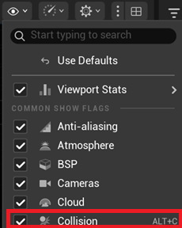

# 트러블슈팅

> Source: https://www.notion.so/35d070f75574801e80cffdd55aecc046
>
> Synced from Notion. Do not edit this generated file directly.

스프라이트 원본 배경색 문제

  - 원본 스프라이트의 배경이 투명해야 했으나 색상이 포함되어 있었습니다. `Detail → Chroma Key Texture → Chroma Key Color`에서 배경 색상을 지정하여 투명 처리했습니다.

Paper2D 기능 한계와 PaperZD 도입

  - Unreal Engine에서 기본 제공하는 Paper2D만으로는 2D 애니메이션 상태 제어 기능이 부족했습니다.

  - 유한 상태 머신 기반 애니메이션을 구성하기 위해 PaperZD 플러그인을 적용했습니다.

    - AI 보조 자료와 공식 GitHub 위키를 참고하여 애니메이션 연동 구조를 정리했습니다.

플레이 중 콜라이더 시각화 방법

  - Unity와 달리 Unreal Engine에서는 플레이 중 콜라이더를 확인하려면 `Ctrl + C`를 눌러 Collision View를 활성화해야 합니다.

PaperZD 플러그인 사용법 정리

  - 애니메이션 연동 작업을 진행하면서 관련 튜토리얼과 GitHub 위키를 참고해 사용 흐름을 정리했습니다.

  - [PaperZD사용방법](https://app.notion.com/p/35e070f7557480788f11e71fa49c1f04) 

  - [@May 12, 2026  개발일지 및 작업기록](https://app.notion.com/p/35e070f75574804b894ef386c0f80c12) 

**블록 낙하 대기 중 플레이어 끼임 버그 (타이밍 이슈)**

  - **원인:** 블록이 낙하 전 `Anticipating` 상태일 때 캐릭터가 아래로 들어가면, 아직 `Falling` 상태가 아니어서 Overlap 기반 사망 판정이 실행되지 않았습니다. 이후 낙하가 시작되어도 이미 겹쳐진 상태라 Overlap 이벤트가 갱신되지 않아 캐릭터가 블록에 끼는 문제가 발생했습니다.

  - **해결:** 블록이 대기 상태를 끝내고 `StartFalling()`을 호출하는 시점에 `IsOverlappingActor()`를 추가로 검사했습니다. 불필요한 배열 순회나 메모리 할당 없이 플레이어 Pawn과의 직접 겹침 여부만 확인하도록 방어 코드를 추가했습니다.

교통체증 버그 및 블랙홀 버그

  - 블록 매치와 연쇄 파괴를 구현하는 과정에서, 레이캐스트를 `Tick` 기반으로 관리할 경우 미세한 위치 오차로 블록이 공중에 멈추는 문제가 발생했습니다.

  - 조건을 보강하면 모든 블록이 하단으로 몰리는 블랙홀 현상이 발생했습니다.

  - 해결 방법으로 그리드 기반 Flood Fill 구조로 리팩토링하여 논리 좌표 기준으로 블록 상태를 관리했습니다.

인접 블록 연쇄 파괴(Match) 미작동

  - **원인:** 레이캐스트 대신 격자 데이터를 참조해야 했지만, 블록 파괴 시 인접 좌표 탐색 로직이 연결되지 않았습니다.

  - **해결:** `OnInteracted` 시점에 `ExecuteFloodFill`을 호출하고, `GridMap` 데이터를 기준으로 같은 색상의 인접 블록을 `TSet`으로 묶어 동시에 `Pop()` 처리하도록 수정했습니다.

| **구분** | **기존 (물리 기반)** | **개선 (그리드 기반)** |

| **탐색 방식** | LineTrace (레이캐스트) | `TMap<FIntPoint, ABlock*>` 조회 |

| **정확도** | 물리적 오차 발생 가능 | 논리적 좌표로 **100% 정확** |

| **성능** | 매 프레임 물리 연산(레이캐스트) 부하 | **단순 메모리 주소 참조** (매우 빠름) |

  - **최종 아키텍처 (MVC 구조)**
Model (Data): `MapManager`의 `GridMap`(`TMap`)
View (Visual): `ABlock`의 Sprite, Flipbook, Shake 효과
Controller (Logic): `MapManager`의 `ProcessFalling`, `Block`의 `ExecuteFloodFill`

 디깅 시 순간이동 현상 (Stair Snap)

### 이슈 현상

수직으로 땅을 파고 내려갈 때, 2칸 이상 파괴되면 부드럽게 떨어지지만 1칸만 파면 캐릭터가 다음 블록 위로 순간이동하듯 안착하는 현상이 발생했습니다. 초기에는 디깅 애니메이션 종료 타이밍 문제로 의심했으나, 실제 원인은 캐릭터 이동 컴포넌트의 계단 처리였습니다.

### 원인 분석: `MaxStepHeight`와 블록 크기 충돌

원인은 Unreal Engine의 Character Movement Component에 내장된 계단 오르내리기(Step) 물리 시스템이었습니다.

  - **언리얼의 ****`MaxStepHeight`****(최대 계단 높이) 기본값:** `45.0f`

  - **우리 게임의 블록 1칸 크기:** `42.0f`

  1. **1칸 파기 (순간이동 발생):** 발밑의 블록 1개(42)를 파괴하면 다음 바닥까지의 거리가 42가 됩니다. 엔진은 이를 낙하가 아니라 계단을 한 칸 내려가는 동작으로 판단해 캐릭터를 다음 블록 위로 즉시 스냅시켰습니다.

  2. **2칸 이상 파기 (부드러운 낙하):** 블록 2개가 연쇄 파괴되어 바닥까지의 거리가 84가 되면, `MaxStepHeight(45)`보다 깊기 때문에 엔진이 이를 낙하로 인식하고 `MOVE_Falling` 상태로 전환했습니다.

### 해결 방법: 가변형 `MaxStepHeight`

입력(`AddMovementInput`)을 단순히 막는 방식 대신, 캐릭터의 등판 가능 높이를 상황에 따라 조절하는 방식으로 해결했습니다.

  1. **평상시:** `MaxStepHeight`를 `0`으로 설정하여 블록을 자동으로 넘지 못하게 했습니다.

  2. **벽 감지 시:** 방향키를 누른 상태로 벽에 막히면 짧은 지연 시간을 부여했습니다. 이 유예 시간 동안 플레이어는 옆 블록을 자연스럽게 파낼 수 있습니다.

  3. **등판 허용:** 지연 시간이 지난 뒤에도 같은 방향 입력이 유지되면 `MaxStepHeight`를 `45`로 올려 1칸 블록을 자연스럽게 올라갈 수 있도록 했습니다.
블록 2칸은 높이가 84이므로, 계단 높이를 45로 열어도 의도치 않게 2칸을 올라가는 문제는 발생하지 않습니다.

`MSB3073 (코드: 6)` 빌드 에러 및 `LNK2019` 링커 에러

  - **원인:** C++에서 UMG 핵심 클래스와 `PaperSprite`를 제어하려 했으나, `Build.cs`에 필요한 종속 모듈이 선언되지 않아 참조를 찾지 못했습니다.

  - **해결:** `MiniDriller.Build.cs` 파일에 `"UMG"`, `"Paper2D"`, `"Slate"`, `"SlateCore"` 모듈을 명시적으로 추가하여 링커 에러를 해결했습니다.

`OxygenImage is not blueprint visible` 권한 경고

  - **원인:** UE5의 마크업 검사가 강화되면서, C++ `BindWidget` 변수를 블루프린트 에디터가 접근하는 부분에서 경고가 발생했습니다.

  - **해결:** 헤더 파일의 `UPROPERTY` 매크로에 `BlueprintReadWrite` 권한을 명시하여 해결했습니다.

C++ 코드 수정 후 산소 게이지 및 UI 미작동

  - **원인:** Unreal Engine 5의 라이브 코딩 컴파일(`Ctrl + Alt + F11`)을 실행하지 않아, 수정된 C++ 바이너리가 에디터 런타임에 반영되지 않았습니다.

  - **해결:** 라이브 코딩을 정상 실행한 뒤, 서브시스템 데이터(산소 소모 및 사망 루프)와 UI가 연동되는 것을 확인했습니다.

다중 블록 파괴 시 사운드 중첩 및 논리 오류

  - **원인:** 여러 블록이 동시에 파괴될 때 `Pop()` 함수가 반복 호출되면서 사운드가 과도하게 중첩되었습니다. 또한 공중에 떠 있는 블록을 직접 채굴하면 `FloodFill` 알고리즘이 잘못된 기준으로 인접 블록을 탐색하는 엣지 케이스가 발생했습니다.

  - **해결:** 1. 사운드 재생 주체를 블록의 `Pop()`에서 이벤트 주체(`OnInteracted`, `CheckMatch`)로 옮겨 1회만 재생되도록 정리했습니다.
2. 블록 상태가 `Idle`이 아닐 때는 채굴 입력을 무시하도록 방어 코드를 추가했습니다.

Issue 2. `MSB3073 (코드: 6)` 빌드 에러

  - **원인:** 새로운 C++ 클래스(`TitleHUDWidget`)를 추가한 뒤 Visual Studio에서 솔루션 빌드를 시도했으나, Unreal Editor가 실행 중이어서 라이브 코딩 시스템이 `.dll` 파일을 잠그고 있었습니다.

  - **해결:** C++ 클래스를 새로 생성한 뒤에는 Unreal Editor를 종료하고, Visual Studio에서 `Ctrl + Shift + B`로 솔루션을 다시 빌드하는 절차로 해결했습니다.

세이브 데이터 에디터 미갱신 및 타이밍 버그

  - **문제 상황:** 에디터(PIE) 테스트 시 결과창에는 점수가 표시되지만 최고 기록이 갱신되지 않고, 재실행 후 0으로 초기화되는 현상이 발생했습니다.

  - **원인 분석:** 1. **타이밍 불일치:** 산소 고갈 시 `GameStatusSubsystem`이 즉시 사망 이벤트를 방송해 UI 결과창을 표시했지만, 실제 세이브 명령(`SaveGameData`)은 캐릭터 사망 애니메이션 종료 후 실행되었습니다. 이 때문에 UI가 이전 저장 데이터를 읽었습니다.
2. **수명주기(Lifecycle) 문제:** `UWorldSubsystem`은 레벨 전환 시 파괴 후 재생성됩니다. 타이틀(`L_Title`)에서 열었던 세이브 데이터(`currentSaveData`)가 인게임(`L_InGame`)으로 넘어오면서 `nullptr`로 초기화되어 방어 코드에 걸렸습니다.

  - **해결 방법:** UI 결과창 텍스트를 채우기 직전에 `SaveGameData()`를 호출하도록 흐름을 조정했습니다.

    - `SaveGameData()` 내부에서 세이브 데이터가 `nullptr`인 경우 즉시 디스크에서 다시 불러오도록 자가 복구(Auto-Heal) 로직을 추가했습니다.

공중 낙하 블록의 연쇄 파괴 버그

  - **문제 상황:** 공중에서 흔들리거나 추락 중인 블록을 직접 채굴하는 것은 막았지만, 바닥 블록을 채굴할 때 위에서 떨어지던 같은 색 블록이 허공에서 함께 파괴되는 현상이 발생했습니다.

  - **원인 분석:** `ExecuteFloodFill` 알고리즘이 인접 블록 탐색 시 색상만 검사하고 블록의 현재 상태를 확인하지 않아, 낙하 중인 블록까지 탐색 대상에 포함했습니다.

  - **해결 방법:** `ExecuteFloodFill` 조건문에 `CurrentBlock->currentState != EBlockState::Idle` 조건을 추가하여, 완전히 정착한 블록끼리만 연쇄 반응이 일어나도록 제한했습니다.

배리어 타격 시 이터레이터 무효화(Iterator Invalidation) 크래시

  - **문제 상황:** 배리어 블록 파괴 함수 실행 중 `EXCEPTION_ACCESS_VIOLATION reading address 0x0000000000000008` 에러와 함께 엔진이 종료되었습니다.

  - **원인 분석:** `TMap<FIntPoint, ABlock*> GridMap`을 `for (auto& Elem : GridMap)`으로 직접 순회하는 도중, 내부 액터를 초기화하거나 풀로 반환하면서 `TMap` 구조가 변경되었습니다. 이로 인해 순회 중이던 이터레이터가 무효화되어 잘못된 주소를 참조했습니다.

  - **해결 방법:** 스냅샷(Snapshot) 순회 패턴을 도입했습니다. `GridMap.GenerateValueArray(BlocksToClear)`로 별도 배열(`TArray`)에 블록 주소를 복사한 뒤 장부를 비우고, 복사된 배열을 `IsValid(Block)` 검증과 함께 순회하도록 변경했습니다.

오브젝트 풀링 Dirty State로 인한 위치 틀어짐

  - **문제 상황:** 게임을 오래 플레이하면 새로 스폰되는 블록의 격자 정렬이 틀어지는 현상이 발생했습니다.

  - **원인 분석:** 낙하 전 대기 상태에서 `spriteComponent`의 상대 위치를 `sin` 함수로 흔들었는데, 오프셋이 남아 있는 상태로 블록이 풀에 반환되었습니다. 이후 재사용될 때 이전 오프셋이 유지되어 위치가 틀어졌습니다.

  - **해결 방법:** 블록이 풀에 반환되기 전 호출되는 `ResetBlockState()` 함수에 `spriteComponent->SetRelativeLocation(FVector::ZeroVector);`를 추가하여 상대 위치를 초기화했습니다.

버튼 마우스 오버 시 회색 박스로 표시되는 문제

  - **문제 상황:** 타이틀 화면 버튼에 마우스를 올리면 원본 디자인 대신 회색 박스 형태로 표시되었습니다.

  - **원인 분석:** Unreal UMG 버튼은 `Normal`, `Hovered`, `Pressed` 상태별 이미지를 각각 지정해야 합니다. `Normal`에만 텍스트 이미지를 넣고 `Hovered` 슬롯을 비워두어 엔진 기본 스타일이 출력되었습니다.

  - **해결 방법:** 버튼 스타일의 `Hovered`와 `Pressed` 이미지 슬롯에 `Normal`과 동일한 텍스처를 할당하고, Tint 값을 흰색으로 고정했습니다. 마우스 오버 시에는 크기만 1.1배 커지도록 연출을 조정했습니다.

