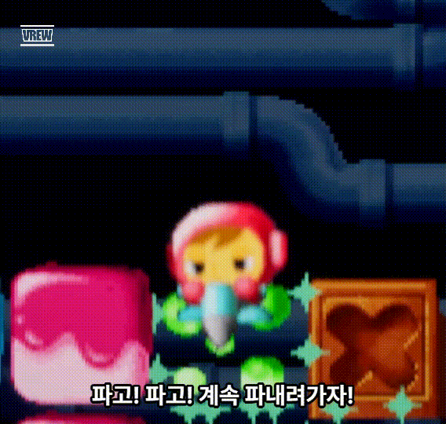
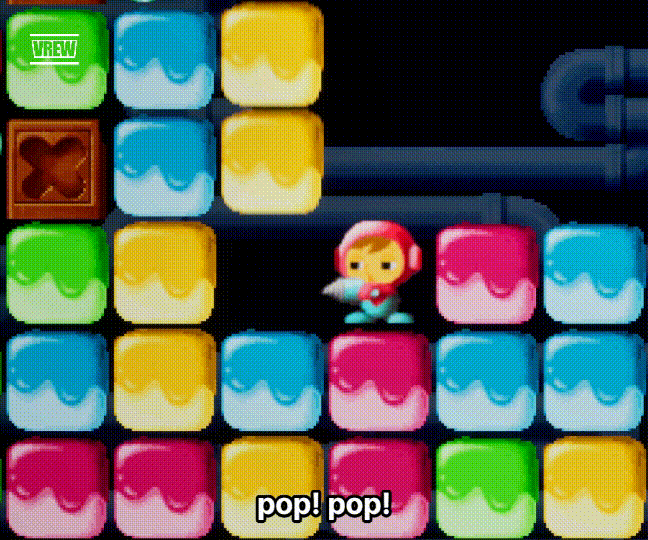

# MiniDriller - 산소가 줄어드는 지하에서 최적의 길을 찾는 2D 채굴 액션

> 본 저장소는 포트폴리오 공개용으로 소스 코드와 기술 문서 중심으로 정리한 버전입니다. 원본 프로젝트의 외부 에셋, 사운드, 스프라이트, 빌드 파일은 저작권과 용량 문제로 제외했습니다.

▶︎ [데모 영상 보기](https://femur-0607.github.io/MiniDriller/) | ▶︎ [상세 보고서 보기](https://docs.google.com/document/d/1R16VHIQMoWL0ZIOksFVcUJ_Kg6zgPkv9WOG_QZcaf5o) | ▶︎ [실행 파일 다운로드](https://drive.google.com/file/d/1x-qpXaKGD_FKAvuG0KbfnGEOkSMdrvWC/view)



## 한 줄 요약
장르: 2D 채굴 액션 / 제작 기간: 2주 / 사용 기술: Unreal Engine 5.6.1, C++, Paper2D, PaperZD / 1인 개발

MiniDriller는 Mr. Driller의 핵심 재미를 참고해 만든 UE5 C++ 기반 2D 채굴 액션 게임입니다.  
플레이어는 블록을 파괴하며 더 깊이 내려가고, 깊어질수록 산소가 줄어들고 장애물 확률이 증가하는 상황에서  
안전한 경로를 선택해야 합니다.

## 핵심 기능
1. **PaperZD 애니메이션 FSM 연동** - Idle, Move, Fall, Dig, Die 상태를 나누고,<br>직접 구성한 PaperZD 블루프린트에서 Anim Notify를 사용해 채굴 종료, 사망 처리, 입력 잠금 해제를<br> 게임 로직과 연결했습니다.
2. **오브젝트 풀링 기반 블록 관리** - 일반, 산소, 장애물, 배리어 블록을 타입별 풀로 미리 생성하고<br> `ResetBlockState()`로 재사용해 레벨 전환 후 남는 좌표와 이중 반납 문제를 줄였습니다.
3. **GridMap 기반 중력·연쇄 시스템** - `TMap<FIntPoint, ABlock*>`을 중앙 장부로 사용해<br> 블록의 화면 위치와 규칙상 좌표를 분리하고, 낙하와 Match-4 연쇄 파괴를 좌표 기준으로 처리했습니다.



## 내가 직접 만든 부분
- 게임 기획, 시스템 설계, UI 구성, 사운드 적용, 테스트, 발표자료 제작을 직접 진행
- PaperZD 애니메이션 블루프린트를 직접 구성하고, 상태 전환과 Anim Notify 흐름을 게임 로직에 맞게 조정
- C++ 구현 과정에서 AI 도구를 활용해 구현 방식과 오류 원인을 비교했고, 직접 코드를 읽고 실행 결과를 검증하며 구조 이해, 수정 방향 결정, 디버깅을 진행
- `AMapManager`, `ABlock`, `ADrillerCharacter`, `UGameStatusSubsystem`의 역할을 파악하고 테스트 중 발견한 문제를 기준으로 수정 사항을 검토
- 외부 에셋: Kenney UI/폰트, The Spriters Resource 스프라이트, 101soundboards 효과음, Gemini 생성 이미지/음악 일부 사용

## 기술적 도전
**문제**: 블록을 연속으로 파괴하면 위쪽 블록이 허공에 멈추거나, 여러 블록이 같은 좌표에 겹치는 문제가 발생했습니다.  
**해결**: 처음에는 충돌 판정 조건을 세분화했지만 프레임마다 판정 순서가 달라지는 문제를 해결하지 못했습니다.  
이후 화면 위치나 물리 충돌에 의존하는 방식 자체가 설계 미스였다고 판단하고, `TMap<FIntPoint, ABlock*>` 기반 GridMap을 중앙 장부로 두어 화면 이동 전에 데이터 좌표를 먼저 확정하도록 구조를 바꿨습니다.  
**배움**: 격자 기반 게임에서는 보이는 위치보다 논리 좌표를 먼저 설계해야 한다는 점을 배웠습니다.<br> 초기에 데이터 기준점을 명확히 잡지 않으면 낙하, 충돌, 매칭 로직이 서로 어긋나고 뒤늦게 조건문으로 막기 어려워진다는 것을 체감했습니다.

→ [상세 트러블슈팅은 프로젝트 보고서 참조](https://docs.google.com/document/d/1R16VHIQMoWL0ZIOksFVcUJ_Kg6zgPkv9WOG_QZcaf5o)

## 기술 스택
- Unreal Engine 5.6.1
- C++
- Paper2D, PaperZD Plugin
- JetBrains Rider
- Git, GitHub

## 실행 방법
1. [실행 파일 다운로드](https://drive.google.com/file/d/1x-qpXaKGD_FKAvuG0KbfnGEOkSMdrvWC/view)에서 빌드된 게임 파일을 받습니다.
2. 압축 파일을 원하는 위치에 해제합니다.
3. 폴더 안의 실행 파일을 실행해 게임을 플레이합니다.

## 개발 환경에서 실행
1. Unreal Engine 5.6.1을 설치합니다.
2. 저장소를 클론합니다.
   ```bash
   git clone https://github.com/femur-0607/MiniDriller.git
   ```
3. `MiniDriller.uproject`를 실행해 언리얼 에디터에서 프로젝트를 엽니다.
4. 필요하면 프로젝트 파일을 생성한 뒤 `MiniDriller.sln`을 `Development Editor` / `Win64`로 빌드합니다.

## 보고서·문서
- [프로젝트 진행 보고서](https://docs.google.com/document/d/1R16VHIQMoWL0ZIOksFVcUJ_Kg6zgPkv9WOG_QZcaf5o) - 전체 개발 과정과 문제 해결 사례
- [기술 문서 인덱스](Docs/Notion/README.md) - Notion에서 동기화한 저장소 내 상세 문서
- [프로젝트 메인 문서](Docs/Notion/project-main.md) - 개발 관리 및 전체 구조 정리
- [트러블슈팅 리포트](Docs/Notion/troubleshooting.md) - 버그 및 크래시 해결 기록

© 2026 Yang Ji-seop. Developed with Unreal Engine 5.
